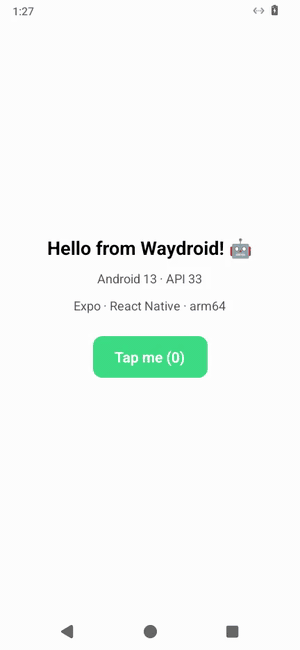

# Android Emulator para Windows on ARM

[English](README.md) · **Español**

Ejecuta un dispositivo Android 13 real **de forma nativa** en laptops Windows on ARM (Surface Pro, Snapdragon X), con `adb` conectado y listo para desarrollar en React Native, Expo, Flutter o Kotlin.

<p align="center">
  
  &nbsp;
  
  &nbsp;
  
</p>
<p align="center"><sub>Fast Refresh en una app de Expo (el contador sobrevive a la edición), el inicio de Android y "Acerca del teléfono". Todo son capturas reales en una Surface Pro; el GIF se hizo con <code>android.ps1 record</code>.</sub></p>

---

## Por qué existe

Si desarrollas apps móviles en una laptop ARM con Windows, seguramente te topaste con esto:

- El Android Emulator de Google no funciona en Windows ARM64.
- Microsoft retiró el Subsistema de Windows para Android en marzo de 2025.
- Los emuladores de terceros están pensados para jugar, no para `adb` y Metro.

Este proyecto cubre ese hueco. Android corre en un contenedor [Waydroid](https://waydro.id) dentro de WSL2. Tu equipo es ARM y Android también, así que no se emula nada: las apps corren a la velocidad nativa del CPU. Se arranca con un comando y Windows lo ve como un dispositivo `adb` normal.

## Lo más importante

- **arm64 nativo.** Sin traducción de instrucciones: los núcleos Snapdragon ejecutan el código de Android directamente.
- **Aparece como un emulador real.** `adb` lo lista como `emulator-5554`, así que Expo, React Native, Flutter y Android Studio lo detectan sin seriales ni `adb connect`. `adb emu avd name` y `adb emu kill` también funcionan.
- **Un comando o un doble clic.** Arranca Android, abre una ventana con tamaño de teléfono, conecta `adb` y configura `adb reverse` para Metro. El diálogo de "¿Permitir depuración USB?" nunca aparece.
- **Hecho para desarrollar.** Funciona de entrada con `adb`, Metro, Expo Go, Fast Refresh y `adb reverse`.
- **Las comodidades de un emulador.** Perfiles de dispositivo (teléfono, pequeño, Pixel, tablet), rotación, capturas y grabación de pantalla, snapshots y *wipe data*, e instalación de APKs desde el menú contextual del Explorador.
- **Recursos con tope.** RAM y CPU limitados (4 GB / 4 núcleos por defecto), para que tu IDE y tu navegador sigan fluidos.
- **Reversible.** Con una opción vuelves al kernel oficial de WSL. En Windows no se instala nada, salvo la configuración de WSL y un acceso directo opcional.

## Probado en

| | |
|---|---|
| Equipo | Surface Pro, Snapdragon X Plus (8 núcleos), 16 GB RAM |
| Sistema | Windows 11 Home ARM64, build 26300 |
| WSL | 2.6.3, WSLg 1.0.71, kernel 6.6.87.2 (+ binder) |
| Android | Waydroid 1.6.2, LineageOS 20 (Android 13, API 33), imagen `arm64_only` |
| Verificado con | `adb`, Expo SDK 58 / Expo Go, Fast Refresh, entrada táctil |

Otros equipos Snapdragon X (X Elite, X Plus, X2) deberían comportarse igual. Si pruebas en uno, cuéntanos cómo te fue con un [reporte de equipo probado](https://github.com/Jmzp/android-emulator-windows-arm/issues/new?template=tested_device.yml).

## Inicio rápido

Necesitas Windows 11 on ARM, WSL 2 (`wsl --version`), `adb.exe` de las platform-tools del Android SDK (`winget install Google.PlatformTools`) y unos 10 GB libres en disco. Desde PowerShell, en la raíz del repo:

```powershell
.\install.ps1
```

Eso es todo. Primero revisa tu equipo y luego ejecuta cada paso: Ubuntu 24.04 en WSL con systemd, un tope de 4 GB / 4 núcleos para WSL, el kernel con binder precompilado, Waydroid con Android (~800 MB, descargados del [mirror en GitHub](#kernels-e-imágenes-de-android-precompilados) de este repo) y un acceso directo en el escritorio. Tarda unos 5 minutos con una buena conexión; una instalación desde cero en la Surface de prueba tomó 2 min 14 s. Se puede volver a ejecutar sin problema: los pasos ya hechos se saltan. Opciones: `-Gapps` (Play Store), `-Start`, `-SkipLimits`, `-NoShortcut`.

<details>
<summary>¿Prefieres ejecutar los pasos tú mismo?</summary>

```powershell
.\windows\setup-wsl.ps1        # 1. Ubuntu 24.04 arm64 en WSL, con systemd
.\windows\configure-wsl.ps1    # 2. Limita WSL a 4 GB de RAM / 4 núcleos
.\windows\install-kernel.ps1   # 3. Descarga y activa el kernel con binder precompilado
.\windows\android.ps1 setup    # 4. Instala Waydroid y descarga Android
.\windows\create-shortcut.ps1  # 5. Ícono "Android Emulator" en el escritorio
```

</details>

Luego arráncalo:

```powershell
.\windows\android.ps1 start
```

```text
==> Opening phone window (432x936)
==> Starting Waydroid session
==> Showing Android
==> Waiting for Android to boot
==> adb bridge: 127.0.0.1:5555 -> 192.168.240.112:5555 (emulator-5554)
==> Ready: emulator-5554  WayDroid arm64 only Device (arm64-v8a)  phone 432x936 @ 180dpi
    adb reverse: 8081, 19000, 19001, 19002 (Metro / Expo)
    Try: npx expo start --android   |   npx react-native run-android   |   flutter run
```

> [!NOTE]
> El instalador modifica `%USERPROFILE%\.wslconfig` (la primera vez guardan una copia en `.wslconfig.bak`) y reinician WSL. **Todas** las distros de WSL usan el kernel propio, incluida Docker Desktop. Es el mismo kernel de Microsoft más binder, así que Docker sigue funcionando.

> [!IMPORTANT]
> El instalador crea un usuario con `sudo` sin contraseña **dentro de la distro Ubuntu** (`/etc/sudoers.d/90-android-wsl`). Eso permite que los scripts de Windows controlen WSL sin quedarse esperando una contraseña.

¿Necesitas los servicios de Google Play para Firebase o AdMob? Mira [Servicios de Google Play](#servicios-de-google-play-firebase-admob-maps).

## Uso diario

```powershell
.\windows\android.ps1 start                  # ventana tamaño teléfono (432x936)
.\windows\android.ps1 start -Device tablet   # un perfil de dispositivo (ver abajo)
.\windows\android.ps1 start -Full            # usa toda la ventana de WSLg
.\windows\android.ps1 start -NoReverse       # sin adb reverse para Metro / Expo
.\windows\android.ps1 rotate                 # vertical <-> horizontal
.\windows\android.ps1 install app.apk        # instala APKs (arranca Android si hace falta)
.\windows\android.ps1 screenshot             # PNG en Imágenes\Android Emulator
.\windows\android.ps1 record                 # MP4 en Videos\Android Emulator; Enter detiene
.\windows\android.ps1 snapshot save limpio   # guarda apps + datos para restaurarlos luego
.\windows\android.ps1 wipe                   # restablece apps y datos de fábrica
.\windows\android.ps1 setup -Gapps          # Play Store + Play Services (-Vanilla para volver)
.\windows\android.ps1 status                 # estado de Waydroid + adb devices
.\windows\android.ps1 doctor                 # revisa toda la instalación, con soluciones
.\windows\android.ps1 stop                   # apaga Android y libera la RAM
```

O usa el ícono del escritorio, como cualquier app:

- **Abrir:** doble clic en **Android Emulator**. Una consola arranca Android y espera a que `emulator-5554` esté listo. Puedes cerrar esa consola cuando quieras.
- **Cerrar:** haz clic en la **X** de la ventana de Android. Android se apaga, el puente adb se detiene y WSL libera la memoria. Es lo mismo que `android.ps1 stop` o `adb emu kill`.
- **Volver a abrir:** doble clic en el ícono otra vez. Android siempre arranca limpio, con el último perfil que usaste.
- **Instalar un APK:** clic derecho sobre él en el Explorador → **Enviar a** → **Android Emulator**.

> [!TIP]
> ¿Algo no anda? Ejecuta `.\windows\android.ps1 doctor`. Revisa Windows, WSL, el kernel, Waydroid, los servicios y `adb`, y muestra la solución de lo que falle.

### React Native / Expo

```powershell
.\windows\android.ps1 start                   # también configura adb reverse para Metro y Expo

npx expo start --android                      # Expo Go (se instala solo la primera vez)
npx expo run:android                          # o un development build
npx react-native run-android                  # o React Native sin Expo
```

Sin `ANDROID_SERIAL` ni `adb connect`: Expo ve un emulador llamado **Waydroid** (`› Opening exp://… on Waydroid`). Fast Refresh funciona como en cualquier dispositivo: guardas un archivo y la pantalla se actualiza sin perder el estado. Si necesitas reenviar más puertos, usa `.\windows\rn-connect.ps1 -Ports 8081, 3000`.

### Perfiles de dispositivo y rotación

Un perfil fija a la vez el tamaño de la ventana y la densidad de pantalla, para que las apps vean la pantalla de un tipo de dispositivo real:

| `-Device` | Ventana (px) | Densidad | Lo que ven las apps |
|---|---|---|---|
| `phone` (por defecto) | 432×936 | 180 dpi | 384×832 dp, un teléfono típico |
| `small` | 405×720 | 180 dpi | 360×640 dp, un teléfono pequeño o antiguo |
| `pixel` | 412×915 | 160 dpi | 412×915 dp, igual que un Pixel 7 |
| `tablet` | 1280×800 | 160 dpi | 1280×800 dp; se activan los layouts de tablet (ancho mínimo ≥ 600 dp) |

`-Window 480x1040` y `-Density 200` reemplazan cualquiera de los dos valores. Cambiar de perfil, o rotar, reinicia Android (~30 s), porque la ventana no puede cambiar de tamaño mientras Android corre. `rotate` invierte la última ventana que usaste: `start -Device pixel` seguido de `rotate` te da un Pixel en horizontal. El ícono del escritorio también puede llevar un perfil: `.\windows\create-shortcut.ps1 -Device pixel`.

### Copiar y pegar

El portapapeles se comparte en ambos sentidos: copia texto en Windows y pégalo en Android (Ctrl+V o mantener presionado → Pegar), o copia en Android y pégalo en Windows. Solo texto; las imágenes y los archivos no pasan. Detrás hay un pequeño módulo de Weston ([`clipboard-bridge.c`](wsl/clipboard/clipboard-bridge.c)) que se compila en el primer arranque después de `setup`, porque el portapapeles de Android vive dentro de la ventana de Weston anidado, que por sí sola no lo comparte con WSLg.

La ventana además aparece como **Android Emulator**, con su propio ícono y botón en la barra de tareas, en vez de "Weston Compositor" agrupada con WSL. Clic derecho en su botón de la barra de tareas → *Anclar a la barra de tareas* para arrancar el emulador desde ahí.

### Capturas y grabación de pantalla

```powershell
.\windows\android.ps1 screenshot                # Imágenes\Android Emulator\screenshot-<fecha>.png
.\windows\android.ps1 screenshot bug.png        # o la ruta que quieras
.\windows\android.ps1 record                    # Enter detiene (máximo 3 min)
.\windows\android.ps1 record -Seconds 15 demo.mp4
```

Las grabaciones son MP4 H.264 a 15 fps, de sobra para reportar bugs o mostrar un pull request. Se capturan desde WSL, porque el `screenrecord` de Android se cuelga en Waydroid. La primera grabación instala `ffmpeg` dentro de la distro.

### Snapshots y wipe data

Los snapshots guardan los datos de usuario de Android (apps instaladas, sus datos y la configuración), no la imagen del sistema, así que son pequeños (~100 MB) y rápidos:

```powershell
.\windows\android.ps1 snapshot save con-sesion   # Android se reinicia si estaba corriendo
.\windows\android.ps1 snapshot list
.\windows\android.ps1 snapshot restore con-sesion
.\windows\android.ps1 snapshot delete con-sesion
.\windows\android.ps1 wipe                       # como el "Wipe Data" de un AVD: un primer arranque limpio
```

`restore` y `wipe` piden confirmación (`-Force` la omite). Sirven para probar una y otra vez el onboarding, los diálogos de permisos o la primera instalación. Los snapshots se guardan dentro de la distro, en `~/.local/share/android-wsl/snapshots`.

### Servicios de Google Play (Firebase, AdMob, Maps)

La imagen por defecto es LineageOS sin Google (VANILLA). Si tu app usa Firebase Cloud Messaging, inicio de sesión con Google, Maps o AdMob, cambia a la imagen GAPPS, que agrega Play Store y Play Services:

```powershell
.\windows\android.ps1 setup -Gapps      # cambia (~2 min la primera vez); conserva apps y datos
.\windows\android.ps1 register          # copia el Android ID y abre la página de registro de Google
.\windows\android.ps1 setup -Vanilla    # vuelve atrás (~40 s)
```

Google bloquea Play Services en dispositivos que no certificó, así que hay que registrarlo una vez: `register` copia el ID al portapapeles y abre [google.com/android/uncertified](https://www.google.com/android/uncertified). Inicia sesión, pégalo y reinicia Android a los pocos minutos. Cambiar de imagen conserva las apps instaladas y sus datos. La imagen GAPPS descargada queda en caché (~1,2 GB dentro de la distro), así que volver a ella más adelante toma unos 40 segundos.

| Funciona después de registrarlo | No funciona |
|---|---|
| Play Store, Play Services, inicio de sesión con Google | **Play Integrity** (y con él Firebase App Check): el dispositivo no está certificado |
| Firebase: Cloud Messaging, Analytics, Crashlytics, Auth | La verificación silenciosa del login por teléfono de Firebase; usa un reCAPTCHA en su lugar |
| Anuncios de prueba de AdMob, Google Maps | Apps que rechazan dispositivos no certificados (algunas bancarias) |

### Flutter, Android Studio y otras herramientas

Todo lo que usa `adb` ve `emulator-5554`: `adb devices`, `flutter devices`, `flutter run`, `./gradlew installDebug` y el selector de dispositivos de Android Studio. Por ahora solo se verificó de punta a punta el flujo de Expo / React Native. Se agradecen reportes con otras herramientas.

## Cómo funciona

```
Windows 11 ARM64
 └─ VM de WSL2 ─ Ubuntu 24.04 arm64, kernel propio con binder
     ├─ Weston (anidado, kiosk shell) ── una ventana tamaño teléfono en tu escritorio vía WSLg
     │   └─ Waydroid ─ contenedor LXC con LineageOS 20 (Android 13, arm64)
     └─ socat 127.0.0.1:5555 ──► adbd de Android  ◄── adb.exe en Windows (emulator-5554)
         socat 127.0.0.1:5554 ──► emu-console.sh (adb emu avd name / kill)
```

Cada pieza resuelve un problema concreto:

| Problema | Solución |
|---|---|
| El kernel de WSL no trae **binder**, el IPC de Android | [`build-kernel.sh`](wsl/kernel/build-kernel.sh) compila el kernel de Microsoft de la misma versión, más [`waydroid.config`](wsl/kernel/waydroid.config) (binder y las tablas de iptables para la red del contenedor) |
| WSLg siempre maximiza la ventana de Waydroid | Android se dibuja dentro de un **Weston** anidado en modo kiosk, con tamaño de teléfono |
| Con systemd, WSL apaga la distro cuando no hay ningún `wsl.exe` conectado | Un `wsl.exe` oculto que ejecuta [`keep-alive.sh`](wsl/keep-alive.sh) la mantiene viva mientras la ventana de Android está abierta, y luego termina solo. Se lanza vía WMI, así que cerrar la consola no lo mata |
| Android no puede volver a dibujar en una ventana nueva si su compositor desapareció | Cerrar la ventana detiene toda la sesión de Android (un `ExecStopPost` de systemd), así que cada arranque es limpio |
| Los procesos en segundo plano mueren con el `wsl.exe` que los lanzó | Weston, la sesión, la UI, el puente adb y la consola corren como **unidades de usuario de systemd**, con *linger* activado |
| WSL solo reenvía las conexiones IPv6 a `::1`, pero adb busca emuladores en `127.0.0.1` | Los puentes `socat` escuchan en **IPv4**, que WSL reenvía a `127.0.0.1:5555` de Windows, así adb detecta `emulator-5554` solo |
| Las herramientas le piden su nombre a la consola del emulador (`adb emu avd name`) | [`emu-console.sh`](wsl/emu-console.sh) responde en el puerto 5554 como la consola real: `avd name`, `avd status`, `kill` |
| El diálogo "¿Permitir depuración USB?" impide automatizar | `start` autoriza de antemano tu `adbkey.pub` de Windows dentro de Android |
| No hay GPU para el Mesa de Waydroid en WSL | El render usa ANGLE + SwiftShader (por software). Para la UI de una app es de sobra |

## Kernels e imágenes de Android precompilados

No necesitas compilar nada ni esperar descargas lentas.

### Kernels

 Un [workflow de GitHub Actions](.github/workflows/build-kernel.yml) compila el kernel con binder en un runner arm64 nativo y lo publica en [Releases](https://github.com/Jmzp/android-emulator-windows-arm/releases) como `kernel-<versión>`, con el `Image`, su `Image.sha256` y la `config` completa.

`install-kernel.ps1` lee la versión de tu kernel de WSL (`uname -r`), descarga el release correspondiente y verifica el SHA-256 antes de usarlo. Si no hay release para tu versión, lo compila localmente.

```powershell
.\windows\install-kernel.ps1                     # kernel precompilado para tu WSL (cerca de un minuto)
.\windows\install-kernel.ps1 -Version 6.6.87.2   # una versión precompilada específica
.\windows\install-kernel.ps1 -Build              # compilarlo localmente (20-60 min)
```

Los nuevos releases del kernel de Microsoft se detectan cada lunes, y cualquier cambio en `wsl/kernel/` recompila todos los kernels publicados. Para compilar otra versión a pedido: **Actions → Build WSL kernel → Run workflow**, con tags como `linux-msft-wsl-6.18.54.1`. Los forks pueden apuntar el instalador a sus propios releases con `ANDROID_WSL_RELEASE_REPO`.

### Imágenes de Android

Waydroid descarga Android desde SourceForge, que en el equipo de prueba bajaba a ~200 KB/s: una instalación desde cero tardó más de una hora. Un [segundo workflow](.github/workflows/mirror-android-images.yml) copia cada miércoles las imágenes oficiales más recientes al release [`android-images`](https://github.com/Jmzp/android-emulator-windows-arm/releases/tag/android-images), después de verificar que cada SHA-256 coincida con el canal oficial de Waydroid. También publica los archivos de canal OTA correspondientes en el branch [`ota`](https://github.com/Jmzp/android-emulator-windows-arm/tree/ota).

`setup-waydroid.sh` apunta `waydroid init` a ese canal cuando tiene tu arquitectura (`arm64_only` o `arm64`) y tu tipo de imagen, y si no, usa el canal oficial de Waydroid. Los `waydroid upgrade` posteriores también usan el mirror. Las imágenes no se modifican. Solo se replican las imágenes VANILLA: las GAPPS incluyen apps propietarias de Google, que este repo no redistribuye. Para esas, [`install-images.py`](wsl/install-images.py) descarga desde el canal oficial de Waydroid con 16 conexiones en paralelo (SourceForge limita cada conexión, no el total), verifica el SHA-256 y guarda el zip en caché: en las pruebas tomó ~2 minutos en vez de más de una hora. Un fork puede replicar GAPPS de todos modos con el input `system_types` del workflow (o una variable de repositorio `MIRROR_SYSTEM_TYPES`).

## Configuración

### RAM y CPU

Android vive dentro de la VM de WSL, así que los límites de `.wslconfig` son sus límites reales. Son topes, no reservas: la memoria que Android no usa vuelve a Windows (`autoMemoryReclaim=dropCache`).

```powershell
.\windows\configure-wsl.ps1                            # por defecto: 4 GB, 4 núcleos, 4 GB de swap
.\windows\configure-wsl.ps1 -MemoryGB 6 -Processors 6  # más holgura
```

Android 13 usa unos 2–3 GB en reposo, así que 4 GB alcanzan para desarrollar. Si compilas el kernel localmente (`-Build`), sube a 6 GB o más mientras tanto: el enlazado consume mucha memoria.

### Tamaño y densidad de pantalla

El tamaño de la ventana es el tamaño de pantalla que ve Android. Usa un [perfil de dispositivo](#perfiles-de-dispositivo-y-rotación) o fija ambos a mano: `start -Window 480x1040 -Density 200`. `start` aplica la densidad en cada arranque, así que un `adb shell wm density` manual dura hasta el siguiente arranque.

### Variables de entorno

| Variable (Windows) | Por defecto | Uso |
|---|---|---|
| `ANDROID_WSL_DISTRO` | `Ubuntu-24.04` | Distro de WSL que hospeda Android. Defínela antes de `install.ps1` para instalar Ubuntu 24.04 con otro nombre y mantener Android separado de un Ubuntu que ya uses |
| `ANDROID_WSL_ADB_PORT` | `5555` | Puerto adb; un número impar de 5555 a 5585. El serial es `emulator-<puerto - 1>` |
| `ANDROID_WSL_RELEASE_REPO` | `Jmzp/android-emulator-windows-arm` | De dónde se descargan los kernels precompilados y el mirror de imágenes de Android |

Las propiedades de sistema de Android están en la sección `[properties]` de `/var/lib/waydroid/waydroid.cfg`, que inicializa [`setup-waydroid.sh`](wsl/setup-waydroid.sh). Después de editarlas, ejecuta `sudo waydroid upgrade --offline`.

## Estructura del proyecto

```
install.ps1                  Instalador en un paso (verificaciones + todos los pasos)
.github/workflows/
  build-kernel.yml           Compila el kernel en runners arm64 y publica los Releases
  lint.yml                   shellcheck + PSScriptAnalyzer en cada push y pull request
  mirror-android-images.yml  Replica las imágenes de Android de Waydroid (script en .github/scripts/)
.github/ISSUE_TEMPLATE/      Plantillas de bug y de equipo probado
PSScriptAnalyzerSettings.psd1  Reglas de lint para los scripts de PowerShell
windows/                     PowerShell, se ejecuta desde Windows
  setup-wsl.ps1              Instala y prepara la distro Ubuntu
  configure-wsl.ps1          Límites de RAM / CPU / swap para WSL
  install-kernel.ps1         Descarga (o compila con -Build) y activa el kernel con binder (-Revert para deshacer)
  android.ps1                start | stop | rotate | install | screenshot | record |
                             snapshot | wipe | status | doctor | setup | register
  doctor.ps1                 Diagnóstico detrás de `android.ps1 doctor`
  rn-connect.ps1             Puertos extra de adb reverse (start ya hace Metro / Expo)
  create-shortcut.ps1        Acceso directo con ícono, más el instalador de APKs en "Enviar a"
  window.ps1                 Ícono y botón propio de la ventana en la barra de tareas
  common.ps1                 Funciones compartidas
wsl/                         Bash, corre dentro de la distro
  kernel/build-kernel.sh     Clona, configura y compila el kernel de WSL
  kernel/waydroid.config     Fragmento de Kconfig (binder, netfilter)
  setup-waydroid.sh          Instala Waydroid, descarga Android y fija propiedades
  start-android.sh           Weston + sesión + UI + puente adb + consola (unidades de systemd)
  emu-console.sh             Consola mínima de emulador para `adb emu`
  doctor.sh                  Verificaciones de Linux para `doctor`
  stop-android.sh            Detiene todo lo anterior
  snapshot.sh                Guarda / restaura / borra los datos de Android
  record.py                  Grabación de pantalla (cuadros de screencap -> ffmpeg)
  install-images.py          Instala / cambia las imágenes de Android (mirror o descarga en paralelo)
  gsf-id.sh                  Android ID para el registro del dispositivo con Google
  clipboard/                 Portapapeles compartido: módulo de Weston + ayudante de Windows
  authorize-adb.sh           Autoriza una clave adb de Windows dentro de Android
  keep-alive.sh              Mantiene WSL encendido mientras la ventana de Android está abierta
assets/                      Ícono del acceso directo
docs/images/                 Capturas de pantalla
ROADMAP.md                   Lo que viene
```

## Solución de problemas

Empieza con `.\windows\android.ps1 doctor`: hace unas 30 verificaciones y muestra la solución de cada fallo. Para ir más a fondo, todo lo relacionado con Android corre como unidades de usuario de systemd dentro de la distro (`waydroid-weston`, `waydroid-session`, `waydroid-adb-bridge`, `waydroid-emu-console`):

```bash
wsl -d Ubuntu-24.04
journalctl --user -u waydroid-session -u waydroid-ui -u waydroid-weston
sudo waydroid logcat -b crash       # crashes de Android
sudo tail /var/lib/waydroid/waydroid.log
```

**Kernel y WSL**

| Síntoma | Solución |
|---|---|
| `binder is not available` | `wsl -d Ubuntu-24.04 -- uname -r` debe terminar en `-waydroid`. Si no, revisa `kernel=` en `.wslconfig` y ejecuta `wsl --shutdown`. |
| La compilación del kernel se corta sin error y WSL "se reinicia" cada ~90 s | El OOM killer mató algo, y systemd (`OOMPolicy=stop`) sigue deteniendo todo lo lanzado desde `wsl.exe`. Ejecuta `wsl --shutdown`, sube la RAM con `configure-wsl.ps1` y vuelve a compilar. La compilación es incremental. |
| `CONFIG_... did not end up =y` | La rama del kernel cambió sus dependencias. Revisa `make menuconfig` en `~/wsl-kernel-build/WSL2-Linux-Kernel`. |
| WSL se actualizó a otra versión de kernel | No se rompe nada, porque tu kernel sigue cargándose. Para seguir la nueva versión, ejecuta otra vez `install-kernel.ps1`. |
| Los scripts se cuelgan y `wsl -l -v` no responde | El servicio de WSL se trabó. Ejecuta `wsl --shutdown --force` (si hace falta, cierra antes los `wsl.exe` sueltos) y luego `android.ps1 start`. |

**Android y Waydroid**

| Síntoma | Solución |
|---|---|
| `waydroid-net.sh` falla con `table mangle does not exist` | Tu kernel es anterior a las opciones de netfilter. Ejecuta otra vez `install-kernel.ps1` con el `waydroid.config` actual. |
| Pantalla negra, y `system_server` crashea en `getCompositionColorSpaces` | El compositor rechazó el tamaño del buffer. No fijes `persist.waydroid.width/height`: lo controla el tamaño de la ventana (`-Window`). |
| Ventana negra al volver a abrir | Android seguía corriendo desde una ventana que ya no existe. Los scripts actuales lo resuelven; si pasa, ejecuta `android.ps1 stop` y luego `start`. |
| Android se apaga solo | Desapareció el `wsl.exe` oculto que lo mantiene vivo. Ejecuta `android.ps1 start` de nuevo. |
| Android sin internet | `sudo waydroid container restart`, y luego revisa que `sudo iptables -t nat -L` tenga reglas para `waydroid0`. |

**adb**

| Síntoma | Solución |
|---|---|
| `emulator-5554` no aparece | `start` lo registra en el servidor de adb que esté corriendo. Si aun así no aparece, ejecuta `adb kill-server` y luego `adb devices`, o ejecuta `doctor`. `127.0.0.1:5555` debe estar reenviado desde WSL (no pongas `localhostForwarding=false` en `.wslconfig`) y la unidad `waydroid-adb-bridge` debe estar activa. |
| El dispositivo aparece dos veces (`emulator-5554` y `<ip>:5555`) | Es una conexión vieja por IP. `start` la elimina; o ejecuta `adb disconnect <ip>:5555`. |
| `failed to authenticate` | Regeneraste `%USERPROFILE%\.android\adbkey`. Ejecuta `android.ps1 start` de nuevo para autorizar la nueva clave. |
| El dispositivo aparece `offline` | Android se detuvo o WSL se reinició. Ejecuta `android.ps1 start`. |

## Limitaciones

- **No es un AVD.** Aparece como `emulator-5554`, pero el Device Manager de Android Studio no puede administrarlo. Para perfiles, snapshots y wipes usa `android.ps1`.
- **Rotar reinicia Android.** La ventana no puede cambiar de tamaño mientras Android corre, así que `rotate` y los cambios de perfil toman un reinicio de ~30 s.
- **Render por software.** Sirve para la UI de apps y para desarrollar, pero no para juegos o 3D pesado.
- **Una sola versión de Android.** LineageOS 20 (Android 13, API 33). No se puede cambiar de nivel de API como con las imágenes de AVD.
- **Solo apps arm64.** Los Snapdragon X no ejecutan código ARM de 32 bits, así que Waydroid usa la imagen `arm64_only`. Las apps solo x86 o solo `armeabi-v7a` no se instalan. Los builds de React Native y Expo incluyen `arm64-v8a` por defecto.

## Desinstalar

```powershell
.\windows\android.ps1 stop
.\windows\install-kernel.ps1 -Revert           # vuelve al kernel oficial de WSL
wsl --unregister Ubuntu-24.04                  # borra la distro y todo su contenido
Remove-Item "$env:USERPROFILE\wsl-kernel" -Recurse
Remove-Item "$([Environment]::GetFolderPath('Desktop'))\Android Emulator.lnk"
Remove-Item "$([Environment]::GetFolderPath('SendTo'))\Android Emulator.lnk"
```

Para recuperar tus límites anteriores de WSL, copia `%USERPROFILE%\.wslconfig.bak` encima de `.wslconfig`.

## Roadmap

Las Fases 1 y 2 están completas: perfiles de dispositivo, rotación, snapshots, capturas, grabación, instalación de APKs, servicios de Google Play, portapapeles compartido y un título e ícono propios para la ventana. Lo siguiente: investigar la aceleración por GPU y una app en la bandeja del sistema. Mira [ROADMAP.md](ROADMAP.md) (en inglés). Las ideas y los pull requests son bienvenidos.

## Créditos

- [Waydroid](https://waydro.id) ejecuta Android en un contenedor Linux.
- [LineageOS](https://lineageos.org) aporta las imágenes de Android que usa Waydroid.
- [Microsoft WSL2-Linux-Kernel](https://github.com/microsoft/WSL2-Linux-Kernel) es el kernel que este proyecto extiende con binder.
- [Weston](https://gitlab.freedesktop.org/wayland/weston) aporta la ventana anidada con tamaño de teléfono.

## Licencia

[MIT](LICENSE). Los scripts de este repo tienen licencia MIT. Waydroid, LineageOS y el kernel de Linux conservan sus propias licencias, y el kernel que compilas localmente es GPL-2.0.
