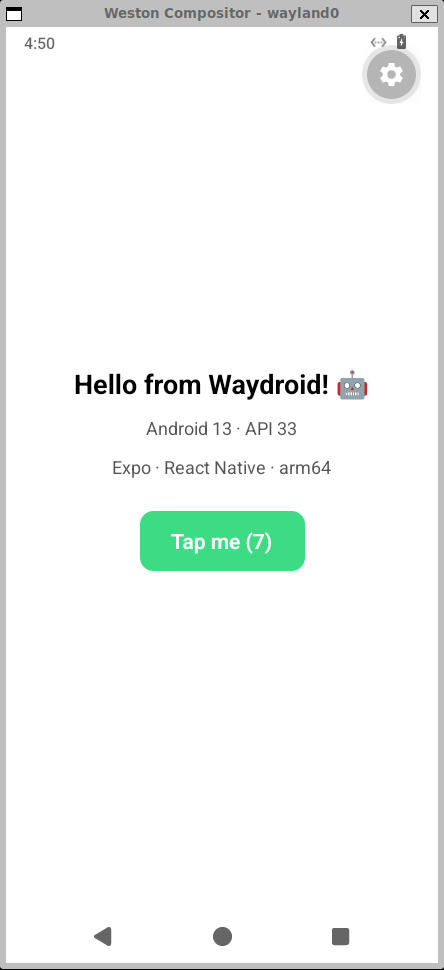
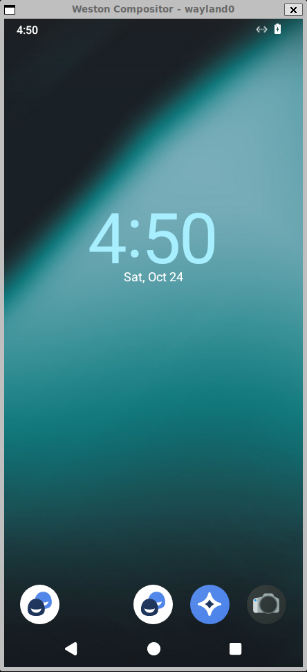
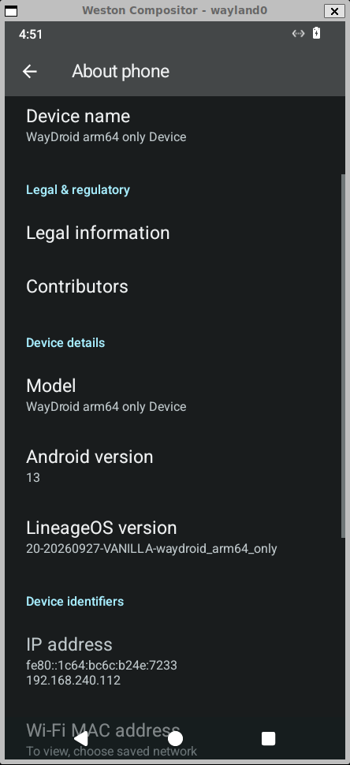

# Android Emulator for Windows on ARM

**English** · [Español](README.es.md)

Run a real Android 13 device **natively** on Windows on ARM laptops (Surface Pro, Snapdragon X), with `adb` connected and ready for React Native, Expo, Flutter or Kotlin development.

<p align="center">
  
  &nbsp;
  
  &nbsp;
  
</p>
<p align="center"><sub>An Expo app with Fast Refresh, the Android home screen, and "About phone". All three are real captures from a Surface Pro.</sub></p>

---

## Why this exists

If you develop mobile apps on an ARM laptop running Windows, you've probably hit this wall:

- Google's Android Emulator doesn't run on Windows ARM64.
- Microsoft retired the Windows Subsystem for Android in March 2025.
- Third-party emulators are built for gamers, not for `adb` and Metro.

This project fills that gap. Android runs in a [Waydroid](https://waydro.id) container inside WSL2. Your machine is ARM and Android is ARM, so nothing gets emulated: apps run at native CPU speed. One command starts it, and Windows sees a regular `adb` device.

## Highlights

- **Native arm64.** No instruction translation. The Snapdragon cores run Android code directly.
- **Shows up as a real emulator.** `adb` lists it as `emulator-5554`, so Expo, React Native, Flutter and Android Studio pick it up with no serials or `adb connect`. `adb emu avd name` and `adb emu kill` work too.
- **One command or one double-click.** It boots Android, opens a phone-sized window, connects `adb` and sets up `adb reverse` for Metro. The "Allow USB debugging?" prompt never shows up.
- **Made for development.** It works with `adb`, Metro, Expo Go, Fast Refresh and `adb reverse` out of the box.
- **Resource caps.** RAM and CPU are limited (4 GB / 4 cores by default), so your IDE and browser stay responsive.
- **Reversible.** One flag puts back the stock WSL kernel. Nothing is installed on Windows itself, apart from WSL settings and an optional desktop shortcut.

## Tested on

| | |
|---|---|
| Device | Surface Pro, Snapdragon X Plus (8 cores), 16 GB RAM |
| OS | Windows 11 Home ARM64, build 26300 |
| WSL | 2.6.3, WSLg 1.0.71, kernel 6.6.87.2 (+ binder) |
| Android | Waydroid 1.6.2, LineageOS 20 (Android 13, API 33), `arm64_only` image |
| Verified with | `adb`, Expo SDK 58 / Expo Go, Fast Refresh, touch input |

Other Snapdragon X machines (X Elite, X Plus, X2) should behave the same way. If you try one, please share how it went.

## Quick start

You need Windows 11 on ARM, WSL 2 (`wsl --version`), `adb.exe` from the Android SDK platform-tools (`winget install Google.PlatformTools`), and about 10 GB of free disk space. From PowerShell, at the repo root:

```powershell
.\install.ps1
```

That's it. It checks your machine first, then runs every step: Ubuntu 24.04 in WSL with systemd, a 4 GB / 4-core cap for WSL, the prebuilt binder kernel, Waydroid with Android (~800 MB download), and a desktop shortcut. It takes 15–25 minutes, mostly the Android download. It's safe to run again: finished steps are skipped. Options: `-Gapps` (Play Store), `-Start`, `-SkipLimits`, `-NoShortcut`.

<details>
<summary>Prefer to run the steps yourself?</summary>

```powershell
.\windows\setup-wsl.ps1        # 1. Ubuntu 24.04 arm64 in WSL, with systemd
.\windows\configure-wsl.ps1    # 2. Caps WSL at 4 GB RAM / 4 cores
.\windows\install-kernel.ps1   # 3. Downloads and enables the prebuilt binder kernel
.\windows\android.ps1 setup    # 4. Installs Waydroid and downloads Android
.\windows\create-shortcut.ps1  # 5. "Android Emulator" icon on the desktop
```

</details>

Then start it:

```powershell
.\windows\android.ps1 start
```

```text
==> Opening phone window (432x936)
==> Starting Waydroid session
==> Showing Android
==> Waiting for Android to boot
==> adb bridge: 127.0.0.1:5555 -> 192.168.240.112:5555 (emulator-5554)
==> Ready: emulator-5554  WayDroid arm64 only Device (arm64-v8a)
    adb reverse: 8081, 19000, 19001, 19002 (Metro / Expo)
    Try: npx expo start --android   |   npx react-native run-android   |   flutter run
```

> [!NOTE]
> The installer edits `%USERPROFILE%\.wslconfig` (a backup goes to `.wslconfig.bak` the first time) and restart WSL. **Every** WSL distro uses the custom kernel, Docker Desktop included. The kernel is Microsoft's own, plus binder, so Docker keeps working.

> [!IMPORTANT]
> The installer creates a user with passwordless `sudo` **inside the Ubuntu distro** (`/etc/sudoers.d/90-android-wsl`). That's what lets the Windows scripts drive WSL without stopping at a password prompt.

Want the Play Store? Install with `.\install.ps1 -Gapps`, then [register the device with Google](https://www.google.com/android/uncertified).

## Daily use

```powershell
.\windows\android.ps1 start                  # phone-sized window (432x936)
.\windows\android.ps1 start -Window 480x1040 # any size you like
.\windows\android.ps1 start -Full            # use the whole WSLg window
.\windows\android.ps1 start -NoReverse       # skip adb reverse for Metro / Expo
.\windows\android.ps1 status                 # Waydroid state + adb devices
.\windows\android.ps1 doctor                 # check the whole setup, with fixes
.\windows\android.ps1 stop                   # shut Android down and free the RAM
```

Or just use the desktop icon, like a regular app:

- **Open:** double-click **Android Emulator**. A console boots Android and waits until `emulator-5554` is ready. You can close that console at any time.
- **Close:** click the **X** on the Android window. Android shuts down, the adb bridge stops and WSL releases the memory. This is the same as `android.ps1 stop` or `adb emu kill`.
- **Reopen:** double-click the icon again. Android always starts fresh.

> [!TIP]
> Something off? Run `.\windows\android.ps1 doctor`. It checks Windows, WSL, the kernel, Waydroid, the services and `adb`, and prints a fix for anything that fails.

### React Native / Expo

```powershell
.\windows\android.ps1 start                   # also sets adb reverse for Metro and Expo

npx expo start --android                      # Expo Go (installed automatically the first time)
npx expo run:android                          # or a development build
npx react-native run-android                  # or bare React Native
```

No `ANDROID_SERIAL`, no `adb connect`: Expo sees an emulator named **Waydroid** (`› Opening exp://… on Waydroid`). Fast Refresh works as on any device: save a file and the screen updates without losing state. If you need more ports reversed, use `.\windows\rn-connect.ps1 -Ports 8081, 3000`.

### Flutter, Android Studio and other tools

Anything that talks to `adb` sees `emulator-5554`: `adb devices`, `flutter devices`, `flutter run`, `./gradlew installDebug`, and Android Studio's device picker. Only the Expo / React Native flow has been verified end to end so far. Reports for other tools are welcome.

## How it works

```
Windows 11 ARM64
 └─ WSL2 VM ─ Ubuntu 24.04 arm64, custom kernel with binder
     ├─ Weston (nested, kiosk shell) ── a phone-sized window on your desktop via WSLg
     │   └─ Waydroid ─ LXC container running LineageOS 20 (Android 13, arm64)
     └─ socat 127.0.0.1:5555 ──► Android's adbd  ◄── adb.exe on Windows (emulator-5554)
         socat 127.0.0.1:5554 ──► emu-console.sh (adb emu avd name / kill)
```

Each piece solves one specific problem:

| Problem | Solution |
|---|---|
| WSL's kernel has no **binder**, Android's IPC | [`build-kernel.sh`](wsl/kernel/build-kernel.sh) builds Microsoft's kernel at the same version, plus [`waydroid.config`](wsl/kernel/waydroid.config) (binder, iptables tables for the container's network) |
| WSLg always maximizes the Waydroid window | Android draws inside a nested **Weston** in kiosk mode, sized like a phone |
| With systemd, WSL shuts the distro down when no `wsl.exe` is attached | A hidden `wsl.exe` running [`keep-alive.sh`](wsl/keep-alive.sh) holds it up while the Android window is open, then exits on its own. It's launched through WMI, so closing the console doesn't kill it |
| Android can't redraw into a new window once its compositor is gone | Closing the window stops the whole Android session (a systemd `ExecStopPost`), so every start is clean |
| Background processes die with the `wsl.exe` that started them | Weston, the session, the UI, the adb bridge and the console run as **systemd user units** with lingering enabled |
| WSL only forwards IPv6 listeners to `::1`, but adb scans `127.0.0.1` for emulators | The `socat` bridges listen on **IPv4**, which WSL forwards to Windows' `127.0.0.1:5555`, so adb auto-detects `emulator-5554` |
| Tools ask the emulator console for its name (`adb emu avd name`) | [`emu-console.sh`](wsl/emu-console.sh) answers on port 5554 like the real console: `avd name`, `avd status`, `kill` |
| The "Allow USB debugging?" prompt blocks automation | `start` pre-authorizes your Windows `adbkey.pub` inside Android |
| No GPU passthrough for Waydroid's Mesa on WSL | Rendering uses ANGLE + SwiftShader (software). That's plenty for app UIs |

## Prebuilt kernels

You don't need to compile anything. A [GitHub Actions workflow](.github/workflows/build-kernel.yml) builds the binder kernel on a native arm64 runner and publishes it under [Releases](https://github.com/Jmzp/android-emulator-windows-arm/releases) as `kernel-<version>`, with the `Image`, its `Image.sha256` and the full `config`.

`install-kernel.ps1` reads your WSL kernel version (`uname -r`), downloads the matching release and checks the SHA-256 before using it. If there's no release for your version, it falls back to a local build.

```powershell
.\windows\install-kernel.ps1                     # prebuilt kernel matching your WSL (about a minute)
.\windows\install-kernel.ps1 -Version 6.6.87.2   # a specific prebuilt version
.\windows\install-kernel.ps1 -Build              # compile locally instead (20-60 min)
```

New Microsoft kernel releases are picked up every Monday. Any change to `wsl/kernel/` rebuilds every published kernel. To build another version on demand: **Actions → Build WSL kernel → Run workflow**, with tags such as `linux-msft-wsl-6.18.54.1`. Forks can point the installer at their own releases with `ANDROID_WSL_RELEASE_REPO`.

## Configuration

### RAM and CPU

Android lives inside the WSL VM, so the VM limits in `.wslconfig` are the real limits. They are caps, not reservations: memory Android isn't using goes back to Windows (`autoMemoryReclaim=dropCache`).

```powershell
.\windows\configure-wsl.ps1                            # default: 4 GB, 4 cores, 4 GB swap
.\windows\configure-wsl.ps1 -MemoryGB 6 -Processors 6  # more headroom
```

Android 13 uses about 2–3 GB at idle, so 4 GB is comfortable for development. If you build the kernel locally (`-Build`), raise it to 6 GB or more for the duration: the link step is memory-hungry.

### Screen size and density

The window size is the screen size Android sees. The default 432×936 at density 180 behaves like a ~384×832 dp phone. You can change it per launch (`-Window 480x1040`) or simulate other devices inside the same window:

```powershell
adb shell wm density 160        # fit more content (or 200 for bigger UI)
adb shell wm size 1080x2340     # different logical resolution, scaled to the window
adb shell wm size reset; adb shell wm density reset
```

### Environment variables

| Variable (Windows) | Default | Purpose |
|---|---|---|
| `ANDROID_WSL_DISTRO` | `Ubuntu-24.04` | WSL distro that hosts Android |
| `ANDROID_WSL_ADB_PORT` | `5555` | adb port; an odd number from 5555 to 5585. The serial is `emulator-<port - 1>` |
| `ANDROID_WSL_RELEASE_REPO` | `Jmzp/android-emulator-windows-arm` | Where `install-kernel.ps1` downloads prebuilt kernels from |

Android system properties live in the `[properties]` section of `/var/lib/waydroid/waydroid.cfg`, which [`setup-waydroid.sh`](wsl/setup-waydroid.sh) initializes. Run `sudo waydroid upgrade --offline` after editing them.

## Project structure

```
install.ps1                  One-step installer (preflight checks + every step)
.github/workflows/
  build-kernel.yml           Builds the kernel on arm64 runners and publishes Releases
windows/                     PowerShell, run from Windows
  setup-wsl.ps1              Install and prepare the Ubuntu distro
  configure-wsl.ps1          RAM / CPU / swap limits for WSL
  install-kernel.ps1         Download (or -Build) and enable the binder kernel (-Revert to undo)
  android.ps1                setup | start | stop | status | doctor
  doctor.ps1                 Diagnostics behind `android.ps1 doctor`
  rn-connect.ps1             Extra adb reverse ports (start already does Metro / Expo)
  create-shortcut.ps1        Desktop shortcut with icon
  common.ps1                 Shared helpers
wsl/                         Bash, runs inside the distro
  kernel/build-kernel.sh     Clone + configure + build the WSL kernel
  kernel/waydroid.config     Kconfig fragment (binder, netfilter)
  setup-waydroid.sh          Install Waydroid, download Android, set properties
  start-android.sh           Weston + session + UI + adb bridge + console (systemd user units)
  emu-console.sh             Minimal emulator console for `adb emu`
  doctor.sh                  Linux-side checks for `doctor`
  stop-android.sh            Stop all of the above
  authorize-adb.sh           Trust a Windows adb key inside Android
  keep-alive.sh              Keep WSL running while the Android window is open
assets/                      Shortcut icon
docs/images/                 Screenshots
ROADMAP.md                   What's planned next
```

## Troubleshooting

Start with `.\windows\android.ps1 doctor`: it runs about 30 checks and prints a fix for each failure. To dig deeper, everything Android-related runs as systemd user units inside the distro (`waydroid-weston`, `waydroid-session`, `waydroid-adb-bridge`, `waydroid-emu-console`):

```bash
wsl -d Ubuntu-24.04
journalctl --user -u waydroid-session -u waydroid-ui -u waydroid-weston
sudo waydroid logcat -b crash       # Android crashes
sudo tail /var/lib/waydroid/waydroid.log
```

**Kernel and WSL**

| Symptom | Fix |
|---|---|
| `binder is not available` | `wsl -d Ubuntu-24.04 -- uname -r` must end in `-waydroid`. If it doesn't, check `kernel=` in `.wslconfig` and run `wsl --shutdown`. |
| The kernel build stops with no error, and WSL "restarts" every ~90 s | Something was OOM-killed, and systemd (`OOMPolicy=stop`) keeps stopping everything started from `wsl.exe`. Run `wsl --shutdown`, raise RAM with `configure-wsl.ps1`, then build again. The build is incremental. |
| `CONFIG_... did not end up =y` | The kernel branch changed its dependencies. Look at `make menuconfig` in `~/wsl-kernel-build/WSL2-Linux-Kernel`. |
| WSL updated to a new kernel version | Nothing breaks, because your kernel keeps loading. To track the new version, run `install-kernel.ps1` again. |
| Scripts hang and `wsl -l -v` doesn't answer | The WSL service is stuck. Run `wsl --shutdown --force` (close stray `wsl.exe` processes first if needed), then `android.ps1 start`. |

**Android and Waydroid**

| Symptom | Fix |
|---|---|
| `waydroid-net.sh` fails with `table mangle does not exist` | Your kernel predates the netfilter options. Run `install-kernel.ps1` again with the current `waydroid.config`. |
| Black screen, and `system_server` crashes in `getCompositionColorSpaces` | The compositor rejected the buffer size. Don't set `persist.waydroid.width/height`: the window size (`-Window`) controls it. |
| Black window after reopening | Android was still running from a window that no longer exists. Current scripts handle this; if it happens, run `android.ps1 stop` and then `start`. |
| Android shuts down on its own | The hidden keep-alive `wsl.exe` is gone. Run `android.ps1 start` again. |
| No internet inside Android | `sudo waydroid container restart`, then check that `sudo iptables -t nat -L` has rules for `waydroid0`. |

**adb**

| Symptom | Fix |
|---|---|
| `emulator-5554` doesn't show up | Run `doctor`. `127.0.0.1:5555` must be forwarded from WSL (don't set `localhostForwarding=false` in `.wslconfig`), and the `waydroid-adb-bridge` unit must be active. |
| The device is listed twice (`emulator-5554` and `<ip>:5555`) | An old IP-based connection. `start` removes it; or run `adb disconnect <ip>:5555`. |
| `failed to authenticate` | You regenerated `%USERPROFILE%\.android\adbkey`. Run `android.ps1 start` again to trust the new key. |
| Device shows as `offline` | Android was stopped or WSL restarted. Run `android.ps1 start`. |

## Limitations

- **Not an AVD.** It shows up as `emulator-5554`, but Android Studio's Device Manager can't create, wipe or configure it like an AVD.
- **Software rendering.** Fine for app UIs and development, but not for games or heavy 3D.
- **One Android version.** LineageOS 20 (Android 13, API 33). You can't switch API levels the way you can with AVD images.
- **arm64 apps only.** Snapdragon X chips can't run 32-bit ARM code, so Waydroid uses the `arm64_only` image. x86 or `armeabi-v7a`-only apps won't install. React Native and Expo builds include `arm64-v8a` by default.

## Uninstall

```powershell
.\windows\android.ps1 stop
.\windows\install-kernel.ps1 -Revert           # back to Microsoft's stock WSL kernel
wsl --unregister Ubuntu-24.04                  # deletes the distro and everything in it
Remove-Item "$env:USERPROFILE\wsl-kernel" -Recurse
Remove-Item "$([Environment]::GetFolderPath('Desktop'))\Android Emulator.lnk"
```

To restore your previous WSL limits, copy `%USERPROFILE%\.wslconfig.bak` back over `.wslconfig`.

## Roadmap

Phase 1 is complete (prebuilt kernels, `emulator-5554`, `install.ps1`, `doctor`, automatic `adb reverse`). Next up: device profiles, shared clipboard, snapshots and GPU acceleration research. See [ROADMAP.md](ROADMAP.md). Ideas and pull requests are welcome.

## Credits

- [Waydroid](https://waydro.id) runs Android in a Linux container.
- [LineageOS](https://lineageos.org) provides the Android images Waydroid uses.
- [Microsoft WSL2-Linux-Kernel](https://github.com/microsoft/WSL2-Linux-Kernel) is the kernel this project extends with binder.
- [Weston](https://gitlab.freedesktop.org/wayland/weston) provides the nested, phone-sized window.

## License

[MIT](LICENSE). The scripts in this repo are MIT-licensed. Waydroid, LineageOS and the Linux kernel keep their own licenses, and the kernel you build locally is GPL-2.0.
